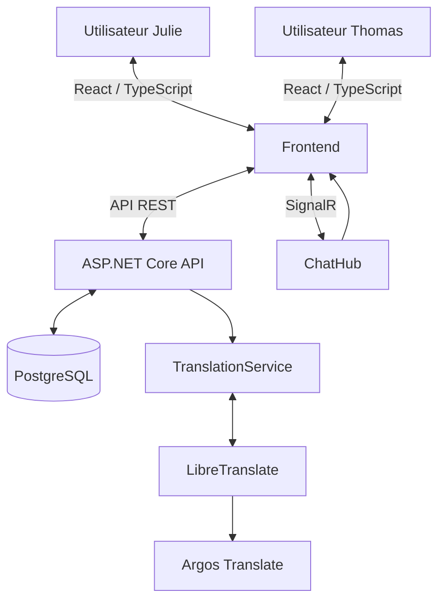

# LiveTranslateChat 🌍

**LiveTranslateChat** est une application de messagerie instantanée multilingue développée avec **C#, ASP.NET Core, React et TypeScript**.

Elle permet à deux utilisateurs de communiquer en temps réel, même lorsqu'ils ne parlent pas la même langue. Les messages sont automatiquement traduits dans la langue préférée de leur destinataire grâce à LibreTranslate et Argos Translate.

L'objectif du projet est de proposer une expérience de messagerie fluide, dans laquelle la barrière de la langue ne constitue plus un obstacle à la communication.

---

## ✨ Fonctionnalités

### 💬 Messagerie en temps réel
- Envoi et réception de messages sans actualisation de la page.
- Communication en temps réel grâce à SignalR.
- Gestion de plusieurs conversations indépendantes.
- Conservation de l'historique des conversations.
- Affichage chronologique des messages.
- Indicateur de saisie pour signaler qu'un utilisateur écrit.

### 🌐 Traduction automatique
- Détection automatique de la langue source.
- Traduction des messages dans la langue préférée du destinataire.
- Conservation du message original.
- Affichage du message traduit et de son contenu original.
- Conservation des emojis pendant la traduction.
- Réutilisation des traductions enregistrées afin d'éviter de retraduire inutilement l'historique.

### 👥 Gestion des utilisateurs
- Gestion de plusieurs profils utilisateurs.
- Adresse e-mail et nom d'utilisateur.
- Définition d'une langue préférée.
- Sélection d'un profil pour tester les échanges entre utilisateurs.

### ✓ Suivi des messages
- Gestion des statuts de distribution et de lecture.
- Actualisation des accusés de lecture en temps réel.
- Synchronisation des statuts entre les participants d'une conversation.

---

## 🛠️ Technologies utilisées

### Backend

| Technologie | Utilisation |
|---|---|
| C# | Langage de programmation |
| ASP.NET Core Web API | Création de l'API REST |
| SignalR | Communication en temps réel |
| Entity Framework Core | Accès aux données et ORM |
| PostgreSQL | Base de données relationnelle |

### Frontend

| Technologie | Utilisation |
|---|---|
| React | Construction de l'interface utilisateur |
| TypeScript | Typage statique |
| Vite | Environnement de développement et build |
| CSS | Mise en forme et design de l'interface |

### Traduction

| Technologie | Utilisation |
|---|---|
| LibreTranslate | API de traduction automatique |
| Argos Translate | Moteur de traduction local |
| Python | Environnement d'exécution de LibreTranslate |

---

## 🏗️ Architecture du projet

Le projet repose sur une architecture séparant le frontend, le backend, la communication en temps réel et le service de traduction.

### Organisation des dossiers

```text
LiveTranslateChat/
│
├── LiveTranslateChat.Api/
│   ├── Controllers/
│   ├── Data/
│   ├── DTOs/
│   ├── Entities/
│   ├── Hubs/
│   ├── Services/
│   ├── Migrations/
│   ├── Program.cs
│   └── appsettings.json
│
├── live-translate-chat/
│   ├── src/
│   ├── public/
│   ├── package.json
│   └── vite.config.ts
│
└── LibreTranslate/
    └── .venv/
```

### Fonctionnement général



### Rôle des différentes couches

**Frontend – React / TypeScript**
- Affichage des conversations et des messages.
- Gestion des profils utilisateurs.
- Envoi des messages à l'API.
- Réception des événements SignalR.
- Affichage des traductions et des statuts de lecture.

**Backend – ASP.NET Core**
- Gestion des utilisateurs, conversations et messages.
- Exposition des endpoints REST.
- Validation des échanges entre utilisateurs.
- Communication avec le service de traduction.
- Persistance des données avec Entity Framework Core.

**Communication temps réel – SignalR**
- Notification de réception des nouveaux messages.
- Gestion des groupes correspondant aux conversations.
- Transmission des indicateurs de saisie.
- Synchronisation des accusés de lecture.

**Base de données – PostgreSQL**
- Stockage des utilisateurs.
- Stockage des conversations.
- Conservation des messages originaux et des traductions.
- Enregistrement des dates et des statuts des messages.

**Service de traduction – LibreTranslate / Argos Translate**
- Détection automatique de la langue source.
- Traduction vers la langue préférée du destinataire.
- Exécution locale du moteur de traduction.
- Protection et conservation des emojis pendant le traitement du texte.

---

## ⚙️ Installation et configuration

### Prérequis

Avant de lancer le projet, installer :

- [.NET SDK](https://dotnet.microsoft.com/download)
- [Node.js et npm](https://nodejs.org/)
- [PostgreSQL](https://www.postgresql.org/)
- [Python](https://www.python.org/) (pour LibreTranslate)
- [Git](https://git-scm.com/)

### 1. Cloner le projet

```bash
git clone <URL_DU_DEPOT_GITHUB>
cd LiveTranslateChat
```

### 2. Configurer PostgreSQL

Créer une base de données PostgreSQL pour l'application.

Configurer ensuite la chaîne de connexion dans la configuration locale du backend.

Ne pas publier les identifiants de connexion ou autres informations sensibles sur GitHub. Utiliser de préférence les User Secrets de .NET ou des variables d'environnement.

### 3. Configurer LibreTranslate

Le backend utilise LibreTranslate à l'adresse suivante par défaut :

```text
http://127.0.0.1:5000
```

La configuration est définie dans `appsettings.json` :

```json
{
  "LibreTranslate": {
    "BaseUrl": "http://127.0.0.1:5000"
  }
}
```

LibreTranslate doit être installé et disposer des modèles de traduction Argos nécessaires.

**Configuration spécifique de mon environnement Windows :**

Les modèles Argos sont stockés séparément dans `D:\ArgosModels`, afin d'éviter un problème de chargement des modèles lié au chemin du profil Windows.

Pour démarrer LibreTranslate depuis PowerShell :

```powershell
cd D:\Projets\LiveTranslateChat\LibreTranslate

$env:ARGOS_PACKAGES_DIR="D:\ArgosModels"

.\.venv\Scripts\libretranslate.exe
```

Laisser ce terminal ouvert pendant l'utilisation de l'application.

> Le chemin `D:\ArgosModels` correspond à mon environnement local. Il doit être adapté si le projet est installé sur une autre machine.

### 4. Configurer et lancer le backend

Ouvrir un nouveau terminal :

```powershell
cd LiveTranslateChat.Api
dotnet restore
```

Appliquer les migrations Entity Framework Core à la base de données :

```powershell
dotnet ef database update
```

Démarrer l'API :

```powershell
dotnet run
```

Dans la configuration actuelle du projet, l'API est accessible à l'adresse :

```text
http://localhost:5009
```

Le hub SignalR est disponible sur :

```text
http://localhost:5009/chatHub
```

### 5. Installer et lancer le frontend

Ouvrir un nouveau terminal :

```powershell
cd live-translate-chat
```

Installer les dépendances :

```powershell
npm install
```

Démarrer le serveur de développement :

```powershell
npm run dev
```

L'application est accessible à l'adresse :

```text
http://localhost:5173
```

---

## 🚀 Démarrage de l'application

Pour utiliser LiveTranslateChat en local, trois services doivent fonctionner simultanément :

| Service | Adresse |
|---|---|
| Frontend React / Vite | http://localhost:5173 |
| API ASP.NET Core | http://localhost:5009 |
| LibreTranslate | http://127.0.0.1:5000 |

Les trois terminaux doivent rester ouverts pendant l'utilisation de l'application.

---

## 🧪 Tests fonctionnels

Quelques scénarios permettent de vérifier le bon fonctionnement de l'application :

- Ouvrir deux sessions avec deux profils différents.
- Sélectionner une langue préférée différente pour chaque utilisateur.
- Envoyer un message dans une langue et vérifier sa traduction chez le destinataire.
- Vérifier la réception instantanée sans actualisation de la page.
- Envoyer plusieurs messages et consulter l'historique.
- Vérifier les accusés de lecture.
- Tester les indicateurs de saisie.
- Vérifier la conservation des emojis dans les messages traduits.

---

## 📸 Captures d'écran

Les captures d'écran suivantes pourront être ajoutées pour illustrer le fonctionnement de l'application :

- Interface principale et liste des conversations.
- Conversation entre deux utilisateurs.
- Exemple de traduction automatique.
- Affichage du message original et de sa traduction.
- Indicateur de saisie.
- Accusés de lecture.

---

## 🔮 Améliorations futures

Plusieurs évolutions sont envisageables pour enrichir le projet :

### Fonctionnalités
- Ajouter un système d'inscription et d'authentification.
- Permettre la création de conversations de groupe.
- Ajouter l'envoi de fichiers et d'images.
- Ajouter une gestion plus avancée des contacts.
- Permettre à chaque utilisateur de modifier ses préférences linguistiques.

### Performances
- Optimiser davantage le traitement des traductions.
- Mettre en place un système de cache des traductions.
- Traiter les traductions de manière asynchrone pour réduire le temps d'attente.
- Améliorer la gestion des reconnexions SignalR.

### Qualité et sécurité
- Ajouter des tests unitaires et des tests d'intégration.
- Renforcer l'authentification et les autorisations.
- Améliorer la gestion des erreurs.
- Ajouter une documentation complète de l'API.

---

## 🎯 Objectif du projet

LiveTranslateChat est un projet personnel réalisé dans le cadre de mon apprentissage et de mon approfondissement du développement Full Stack.

Il me permet notamment de mettre en pratique :

- La conception d'une API REST avec ASP.NET Core.
- La communication temps réel avec SignalR.
- Le développement d'une interface moderne avec React et TypeScript.
- La gestion d'une base de données PostgreSQL avec Entity Framework Core.
- L'intégration d'un moteur de traduction automatique.
- La gestion de données synchronisées entre plusieurs utilisateurs.

Ce projet a également pour objectif de développer une application concrète combinant plusieurs technologies backend et frontend dans une architecture cohérente.

---

## 📄 Licence

Aucune licence n'a encore été définie pour ce projet.

Si le projet est rendu public, une licence pourra être ajoutée selon les conditions de réutilisation souhaitées.
